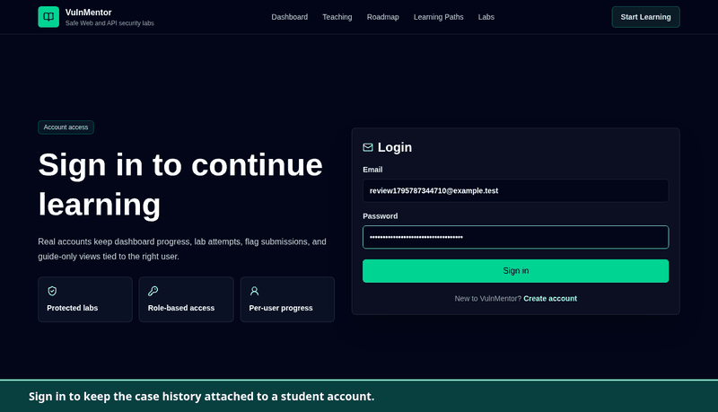
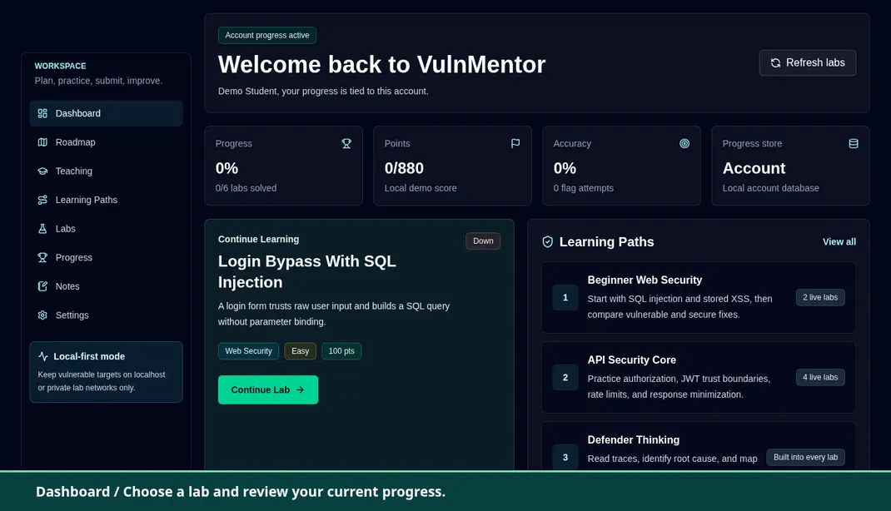
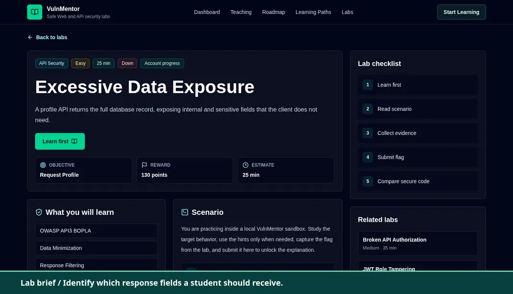
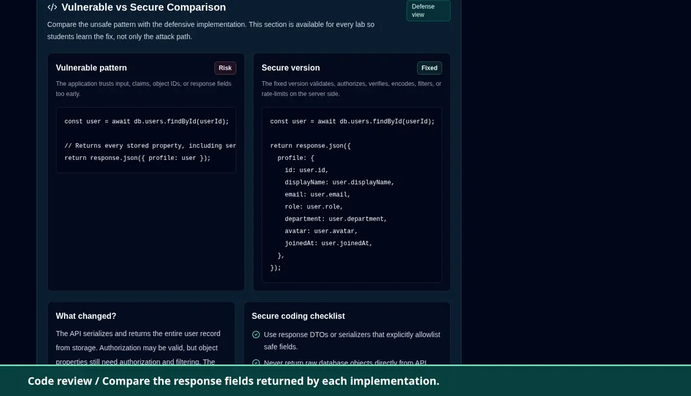
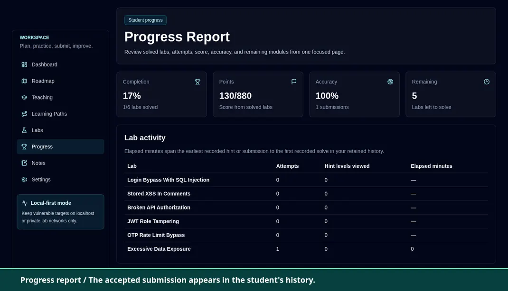
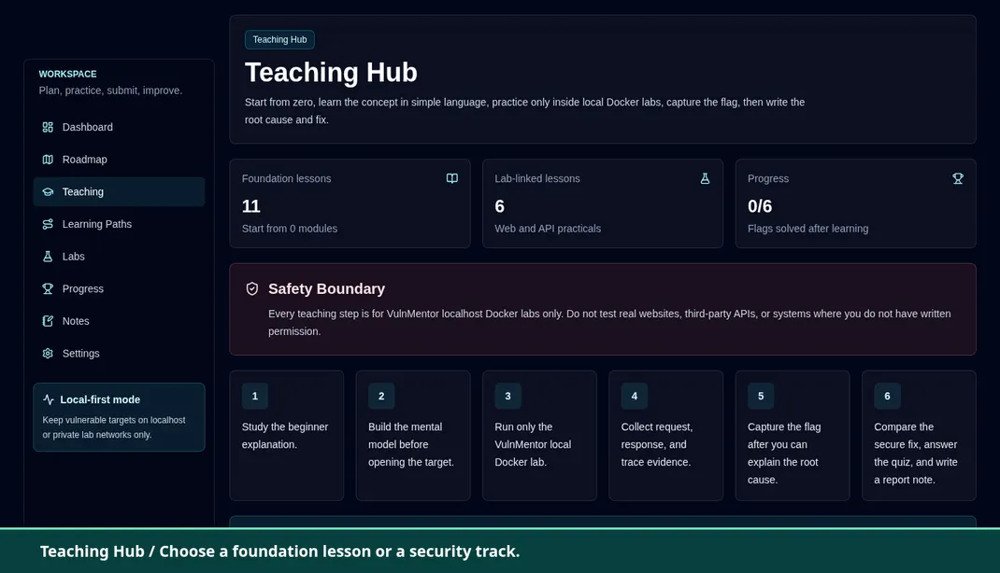
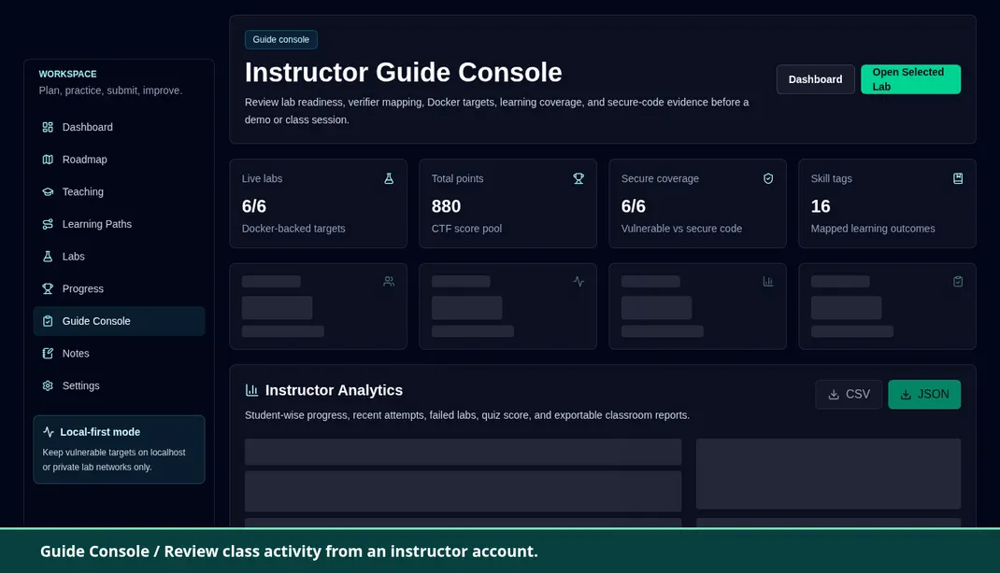
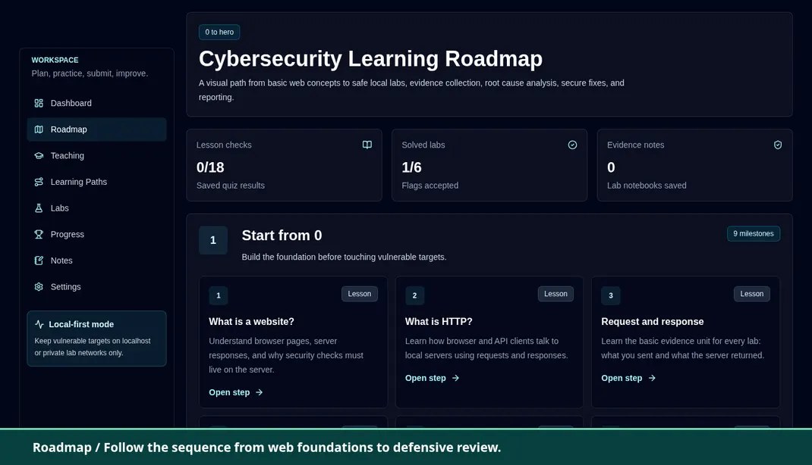

# VulnMentor

[](https://github.com/Pavanxploit/vulnmentor/actions/workflows/ci.yml)
[](docs/TESTING_GUIDE.md)
[](LICENSE)

[](SAFETY.md)

VulnMentor is a security classroom for students and instructors. Students investigate local Web and API labs, submit evidence and flags, compare secure implementations, and track what they learned. Instructors publish lessons, manage classes, and review attempts.

**[Try the public student demo](https://pavan-vulnmentor-demo.humbleflea128.chatgpt.site)** · Open a case, identify the relevant log entry, then select a remediation. Guest access is automatic. The public frontend uses sample data and keeps this visit’s answers in memory. Account sign-in, persistence and Docker labs run in the full portal.

## Walk through the portal



The walkthrough follows a demo student from sign-in to a saved solve. The screenshots below include captions explaining each step.

| Student workspace | Lab brief |
| --- | --- |
|  |  |
| **Implementation comparison** | **Progress report** |
|  |  |
| **Teaching Hub** | **Instructor console** |
|  |  |



## Reviewer guide

| Feature | Where to look |
| --- | --- |
| Six synthetic defensive cases | Public demo or `/demo/index.html` |
| Six local Web and API labs | `/labs` |
| Server-verified completions, elapsed time and hint usage | `/progress` |
| Course authoring and student access | `/courses` |
| Guarded coaching and a post-solve response patch | The Excessive Data Exposure lab |
| Track rankings and completion certificate | `/leaderboard` and `/progress` |
| Runtime health | `/status` |
| Captioned defensive walkthroughs and further reading | Each of the six linked teaching lessons |

## Current Build

- Next.js learning portal
- Docker-based SQL Injection login lab
- Docker-based Stored XSS comment lab
- Docker-based API Broken Authorization / IDOR lab
- Docker-based API JWT tampering lab
- Docker-based API Rate Limit Bypass lab
- Docker-based API Excessive Data Exposure lab
- Lab health check from the portal
- Runtime trace view from the lab
- Challenge filtering by category and difficulty
- Per-lab Docker reset instructions
- Vulnerable vs secure implementation comparison on every lab page
- Teaching Hub with Start from 0, Web Security, API Security, and Defender Thinking tracks
- Dynamic lesson pages such as `/teaching/sql-injection`, `/teaching/stored-xss`, `/teaching/api-bola`, `/teaching/jwt-tampering`, `/teaching/rate-limit-bypass`, and `/teaching/excessive-data-exposure`
- Lesson flow with beginner explanation, mental model, vulnerable code walkthrough, safe local methodology, lab bridge, evidence checklist, mitigation, quiz, report note, and post-lab debrief
- Visual roadmap page at `/roadmap`
- Flag submission workflow
- Account progress and attempt history
- Progressive hints
- Saved quiz results and instructor hint-usage analytics
- Evidence notebook on each lab page
- Per-lab report generator with Markdown, JSON, and CSV output
- Offline AI Mentor with lab-only guardrails
- Safe refusal behavior for real-world target requests
- OWASP mapping and post-solve debrief guidance
- Email/password login and registration
- HTTP-only session cookie with production secure-cookie mode
- Student and instructor roles
- Protected dashboard, teaching, learning paths, labs, progress, notes, settings, flag submission, and guide console routes
- Backend-backed account progress in a local SQLite database, with the original JSON store kept as a fallback
- Guide Console challenge management
- Guide Console instructor analytics for students, attempts, failed labs, quiz scores, and hint usage
- Instructor-only report/guide tooling
- Student progress report and attempt logs dashboard
- Exportable JSON/CSV demo data
- Challenge authoring format reference
- Demo video storyboard and final report/PPT content pack
- Root-cause explanation
- Vulnerable vs secure code comparison
- Mitigation checklist
- Validation script for challenge metadata, protected routes, safety checks, and docs

## Architecture

```text
Learner Browser
    |
    | http://localhost:3000
    v
VulnMentor Portal
    |
    | checks health/traces
    v
Docker Labs on 127.0.0.1:4010 through 127.0.0.1:4060
```

The full classroom portal runs beside the local lab services. The public demo is a separate static frontend.

## Run The Portal

```bash
npm ci
npm run dev
```

Open:

```text
http://localhost:3000
http://localhost:3000/register
http://localhost:3000/login
http://localhost:3000/dashboard
http://localhost:3000/roadmap
http://localhost:3000/teaching
http://localhost:3000/teaching/sql-injection
http://localhost:3000/learning-paths
http://localhost:3000/labs
http://localhost:3000/progress
http://localhost:3000/notes
http://localhost:3000/settings
http://localhost:3000/labs/web-sqli-login
http://localhost:3000/guide
```

The stable pre-redesign version is marked in Git as `backup-before-academy-ui-bfbe0f5`.

Account sessions and progress are stored locally in:

```text
.data/vulnmentor.sqlite
```

SQLite is the default. The original flat-file store is still supported for quick
demos or hand-inspecting data:

```bash
VULNMENTOR_DATABASE_PROVIDER=json npm run dev
```

Upgrading an existing install is a single command, covered in
[docs/DATABASE_PLAN.md](docs/DATABASE_PLAN.md):

```bash
npm run migrate:sqlite
```

The `.data` folder is ignored by Git because it contains local user accounts, password hashes, sessions, and attempt history.

## Run The Labs

Install Docker Desktop, then run:

```bash
docker compose up --build -d
```

Open the labs directly:

```text
http://127.0.0.1:4010
http://127.0.0.1:4020
http://127.0.0.1:4030
http://127.0.0.1:4040
http://127.0.0.1:4050
http://127.0.0.1:4060
```

Reset one lab when you want a clean challenge state:

```bash
docker compose restart stored-xss-comment
```

Reset the full sandbox:

```bash
docker compose down
docker compose up --build -d
```

Health endpoints:

```text
http://127.0.0.1:4010/health
http://127.0.0.1:4020/health
http://127.0.0.1:4030/health
http://127.0.0.1:4040/health
http://127.0.0.1:4050/health
http://127.0.0.1:4060/health
```

Trace endpoints:

```text
http://127.0.0.1:4010/traces
http://127.0.0.1:4020/traces
http://127.0.0.1:4030/traces
http://127.0.0.1:4040/traces
http://127.0.0.1:4050/traces
http://127.0.0.1:4060/traces
```

## Flag Policy

Flags are intentionally not listed in the README. Learners should solve each local lab and submit captured flags through the VulnMentor portal. The portal verifier stores hashed flag values instead of plaintext answers.

## Safe Usage Rules

- Attack only the labs in this repository.
- Do not test payloads against real websites or third-party APIs.
- Do not deploy vulnerable labs publicly without network restrictions.
- Keep flags, secrets, and API keys out of the frontend.
- Use this project for learning, college demonstration, and controlled practice.

More details: [SAFETY.md](./SAFETY.md)

## Project Roadmap

The build plan is tracked in [ROADMAP.md](./ROADMAP.md).

## Documentation

- [Safety and ethics](./SAFETY.md)
- [Run locally](./docs/RUN_LOCALLY.md)
- [Deployment model](./docs/DEPLOYMENT_MODEL.md)
- [Real user platform plan](./docs/REAL_USER_PLATFORM_PLAN.md)
- [Database plan](./docs/DATABASE_PLAN.md)
- [Architecture](./docs/ARCHITECTURE.md)
- [Demo script](./docs/DEMO_SCRIPT.md)
- [Portfolio showcase notes](./docs/PORTFOLIO_SHOWCASE.md)
- [Final presentation checklist](./docs/FINAL_PRESENTATION_CHECKLIST.md)
- [Demo video storyboard](./docs/DEMO_VIDEO_STORYBOARD.md)
- [Final report and PPT content pack](./docs/FINAL_REPORT_AND_PPT_PACK.md)
- [Remaining phases](./docs/REMAINING_PHASES.md)
- [Screenshots](./docs/SCREENSHOTS.md)
- [Testing guide](./docs/TESTING_GUIDE.md)
- [Guide console](./docs/GUIDE_CONSOLE.md)
- [Roadmap](./ROADMAP.md)

## Scripts

```bash
npm run lint
npm run validate
npm run build
npm run screenshots
```

## Tech Stack

- Frontend: Next.js, React, TypeScript
- UI: Tailwind CSS, lucide-react icons
- Labs: Docker Compose
- Lab runtimes: Python HTTP servers, SQLite for SQLi lab, in-memory records for Web/API labs

Planned additions:

- Recorded demo video
- Final report and PPT files in college format
- Optional hosted LLM backend for the guarded mentor workflow
- Optional hosted safe frontend
- Multi-student reporting
- Final demo and deployment guide
